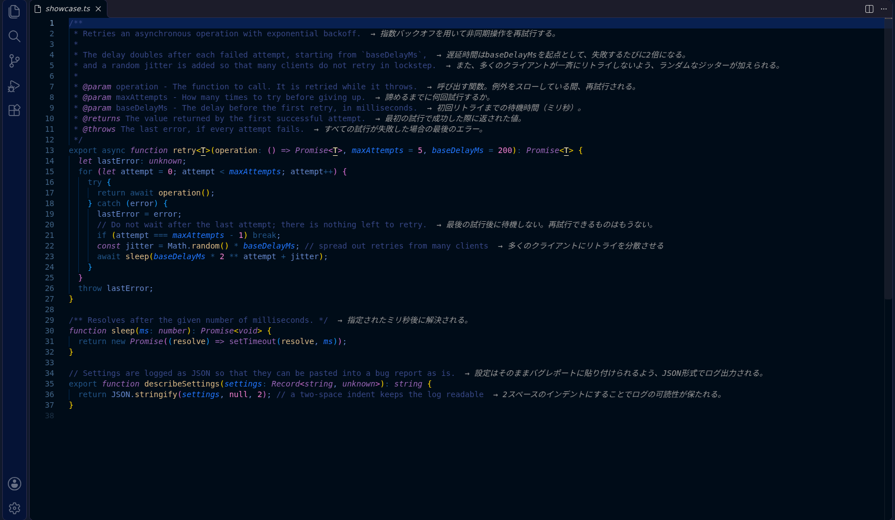
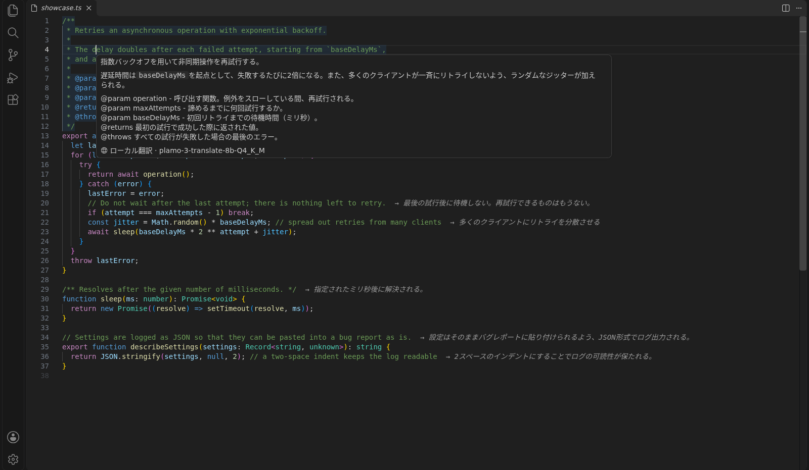
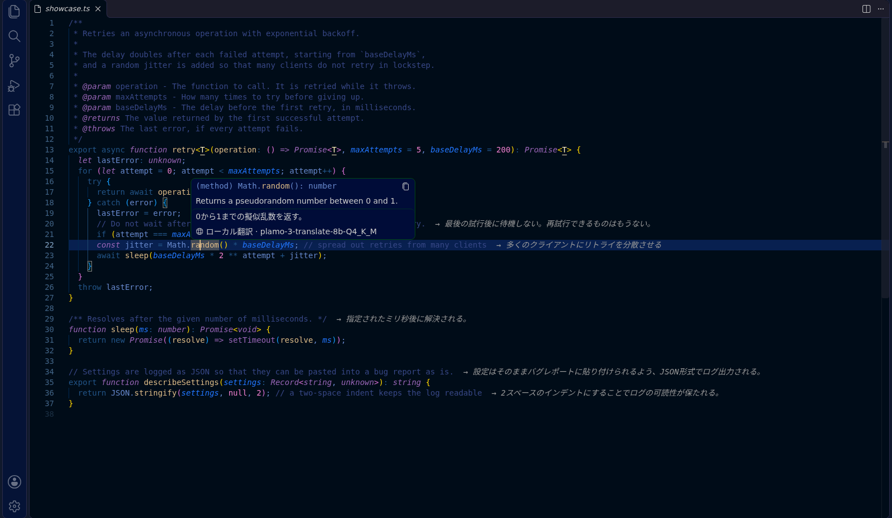

# Interlinear

[English](README.md) | 日本語

ソースコードのコメントと、ホバーで表示されるドキュメントを、**このコンピューターの中だけで**翻訳して表示する VS Code 拡張機能です。ソースは書き換えません。コードや訳文を外部のサービスに送ることもありません。

翻訳には、Preferred Networks の翻訳特化モデル [PLaMo 3 Translate](https://www.preferred.jp/ja/blog/tech/plamo-3-translate-weight-release) を [llama.cpp](https://github.com/ggml-org/llama.cpp) で動かして使います。



この README の画像は、8B のモデルで撮影したものです。

## できること

- **コメントのホバー翻訳**: コメントにマウスを置くと、訳文が表示されます。
  - 対象は、行コメント、ブロックコメント、JSDoc、Python の docstring です。
  - JSDoc の `@param name` などのタグやコード例は、そのまま残します。

  

- **ドキュメントの翻訳**: 関数やクラスにマウスを置いたときに言語サーバーが出す説明に、訳文を追加します。標準ライブラリや `node_modules` の説明も対象です。

  

- **行末の訳文表示**: コメントの右側に、訳文を薄い文字で常に表示します。
  - 長い訳文は省略し、全文はホバーで読めます。
  - 表示する範囲は設定で選べます。既定では行コメントと1行のコメントに表示します。冒頭の画像は、JSDoc なども含める `all` にした場合です。
- **先読みとキャッシュ**: 画面に見えているコメントを先に訳しておきます。訳文は保存され、VS Code を再起動しても残ります。
- **訳さないもの**: ディレクティブ（`eslint-disable` など）、ライセンスヘッダ、コメントアウトされたコード、すでに出力言語で書かれたコメントは訳しません。

対応言語: TypeScript / TSX / JavaScript / Python / Go / Rust / Java / C# / C / C++ / Ruby / PHP / Shell / CSS / PowerShell

## はじめかた

1. 拡張機能をインストールし、対応言語のファイルを開きます。
2. 「翻訳モデルのダウンロードが必要です」と表示されたら **セットアップ** を選びます。ステータスバーの `翻訳: セットアップ` からでも始められます。
3. モデルの大きさを選び、ライセンスに同意すると、ダウンロードが始まります。

| モデル | サイズ | 目安 |
|---|---|---|
| 0.8B | 0.6 GB | 軽量です。GPU のない環境向けです |
| **2B（推奨）** | 1.8 GB | Apple Silicon なら、コメント1件あたり 1 秒未満で訳せます |
| 8B | 5.3 GB | 訳の質が最も高い代わりに、2B の約 3 倍の時間がかかります |

ダウンロードが終わると、翻訳サーバー（llama-server）を拡張が自動で起動・停止します。

- ポートは空いているものを自動で使います。
- しばらく使われなければ、サーバーを止めてメモリを空けます。

### 自分で起動したサーバーを使う

設定 `interlinear.server.mode` を `external` にし、`interlinear.endpoint` にサーバーの URL を指定します。

たとえば、GPU のある別のマシンで llama-server を動かしている場合に使います。モデル（GGUF）は [Hugging Face](https://huggingface.co/pfnet/plamo-3-translate-2b-GGUF) から入手し、次のように起動します。

```bash
llama-server -m plamo-3-translate-2b-Q4_K_M.gguf -c 8192 -np 2 --port 18080
```

- `-np`（同時に処理するリクエストの数）は、`interlinear.maxConcurrentRequests` と同じ値にします。
- 別のマシンから接続する場合は `--host 0.0.0.0` を付けます。同じネットワークの誰からでも接続できるようになる点に注意してください。

### リモート開発（Dev Container / SSH / WSL）

この拡張は、リモートのウィンドウでも、VS Code を開いているコンピューター（ローカル）側で動きます。翻訳サーバーもローカルで動くので、Mac から Dev Container を開いていても GPU（Metal）で翻訳します。モデルもローカルに一度ダウンロードすれば、コンテナごとにダウンロードし直す必要はありません。

リモート側で翻訳したい場合（GPU のある SSH 先など）は、ユーザー設定に次を追加します。

```json
"remote.extensionKind": { "mitsutan.interlinear": ["workspace"] }
```

## 設定

| 設定 | 既定値 | 内容 |
|---|---|---|
| `interlinear.enabled` | `true` | 翻訳の有効・無効 |
| `interlinear.translateDocumentation` | `true` | ホバーで出るドキュメントも翻訳する |
| `interlinear.inlineTranslation` | `short` | コメントの右側に訳文を出す範囲<br>`off`: 出さない<br>`short`: 行コメントと1行のコメント<br>`all`: JSDoc なども含める |
| `interlinear.inlineMaxWidth` | `120` | コードと右側の訳文を合わせた1行の表示幅（全角は2桁）。編集領域の幅に合わせます |
| `interlinear.targetLanguage` | （空） | 出力言語（`ja`、`en`、`zh`、`ko` など）。空なら VS Code の表示言語に合わせます（日本語なら `ja`、それ以外は `en`）。VS Code を英語で表示していて日本語に訳したい場合は `ja` を指定します |
| `interlinear.sourceLanguage` | （空） | 入力言語。空ならモデルが判定します |
| `interlinear.form` | `plain` | 日本語の文体<br>`plain`: 常体<br>`polite`: 敬体<br>`none`: 指定しない |
| `interlinear.useContext` | `true` | ファイル名と関連するコード行を、翻訳の参考情報として渡す |
| `interlinear.glossary` | `[]` | 用語集。例: `[{ "source": "widget", "target": "ウィジェット" }]` |
| `interlinear.prefetch` | `true` | 画面内のコメントを先に訳しておく |
| `interlinear.server.mode` | `managed` | `managed`: 拡張がサーバーを管理する<br>`external`: 自分で起動したサーバーを使う |
| `interlinear.server.model` | `2b` | `managed` で使うモデル（`0.8b` / `2b` / `8b`） |
| `interlinear.server.idleTimeoutMinutes` | `15` | 使われなくなってからサーバーを止めるまでの時間（分）。`0` なら止めない |
| `interlinear.server.llamaServerPath` | （空） | 自分で用意した llama-server のパス。CUDA 版などの GPU 版を使う場合に指定します |
| `interlinear.server.modelPath` | （空） | 自分で用意したモデル（GGUF）のパス |
| `interlinear.endpoint` | `http://127.0.0.1:18080` | `external` で使うサーバーの URL |
| `interlinear.maxConcurrentRequests` | `2` | 同時に送る翻訳リクエストの数 |

コマンドパレットで「Interlinear」と入力すると、次のコマンドを使えます。ステータスバーの項目をクリックしても、同じメニューが開きます。

- セットアップ（モデルの変更もここから）
- 翻訳の有効・無効の切り替え
- 行末表示の切り替え
- サーバーの再起動
- ログの表示
- ダウンロードしたモデルの削除
- キャッシュの削除

## プライバシー

- 翻訳はすべて、VS Code を開いているこのコンピューターで行います（リモート側で動くよう設定した場合は、リモート側）。コードも訳文も外部に送りません。
- 通信するのはセットアップのときだけです。ダウンロード元は llama.cpp（GitHub）とモデル（Hugging Face）で、取得するファイルのバージョンと SHA-256 は拡張に固定してあります。中身が一致しなければ使いません。

## 動作環境

| 項目 | 内容 |
|---|---|
| OS | macOS（Apple Silicon / Intel）、Linux（x64 / arm64）、Windows（x64 / arm64） |
| Linux の glibc | 自動で入れる llama.cpp には、x64 では glibc 2.34 以上（Ubuntu 22.04、Debian 12 以降）、arm64 では glibc 2.38 以上（Ubuntu 24.04、Debian 13 以降）が必要です。古い環境では、llama-server を自分でビルドして `interlinear.server.llamaServerPath` で指定してください |
| GPU | 自動で入れる llama.cpp は、macOS では GPU（Metal）を使い、Linux と Windows では CPU 版です。GPU を使う場合は、GPU 版の llama-server を入れて `interlinear.server.llamaServerPath` で指定してください |
| メモリ | モデルの大きさ程度（2B で約 2 GB）の空きが必要です |

## うまく動かないとき

ステータスバーの項目にマウスを置くか、コメントにホバーすると、理由が表示されます。

| 表示 | 対処 |
|---|---|
| 翻訳モデルがまだダウンロードされていません | セットアップを実行します |
| llama-server が起動直後に終了しました | 「翻訳サーバーのログを表示する」で原因を確認します |
| 自動で入れる llama.cpp には glibc … 以上が必要です | Linux が古いため、自動で入れる llama.cpp が動きません。新しいディストリを使うか、llama-server を自分で用意して `server.llamaServerPath` で指定するか、外部サーバーを使います |
| 翻訳サーバー（…）に接続できません | `external` の場合は、サーバーが起動しているか、`endpoint` のホスト・ポートが合っているかを確認します |
| …で応答したのは llama-server ではありません | そのポートは別のアプリが使っています。サーバーを別のポートで起動し、`endpoint` も合わせます |

## ライセンス

- **この拡張機能**: [MIT License](LICENSE)
- **翻訳モデル**: PLaMo 3 Translate は [PLaMo Community License](https://plamo.preferredai.jp/info/plamo-community-license-ja) で提供されています（Built with PLaMo）。
- **README の画像**: 写っている訳文は PLaMo 3 Translate の出力です。これを学習に使ったモデルには、PLaMo Community License の条件が適用されます。
  - 個人利用、学術を含む非商用利用は無償で、登録も不要です。
  - 商用利用には事前の登録が必要です。売上が 10 億円を超える場合は、別途契約が必要です。
- **その他**: 同梱・利用しているソフトウェアについては [THIRD_PARTY_NOTICES.md](THIRD_PARTY_NOTICES.md) を参照してください。
