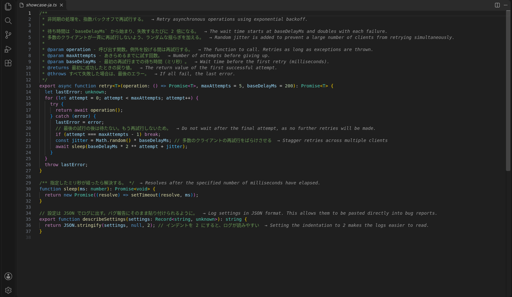
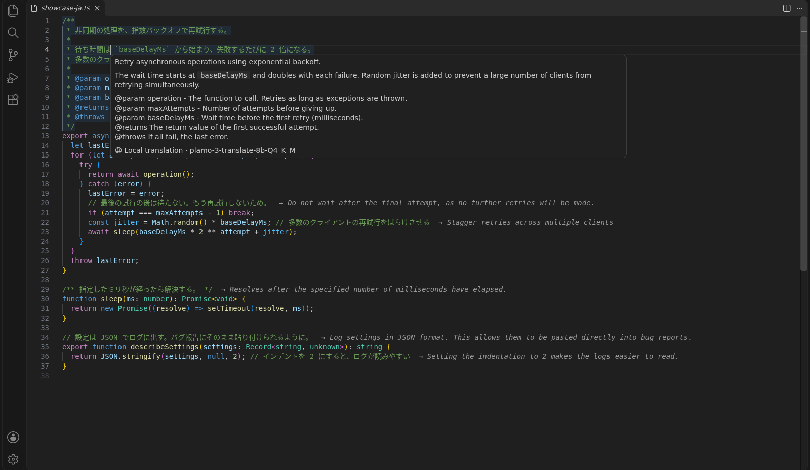
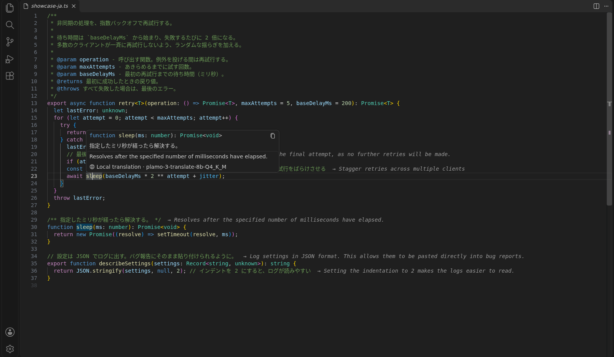

# Interlinear

English | [日本語](README.ja.md)

A VS Code extension that translates code comments and hover documentation **entirely on your computer**. It never modifies your source code, and it never sends your code or the translations to an external service. It helps when you read code whose comments are written in a language you don't read, such as Japanese.

Translation is done by [PLaMo 3 Translate](https://www.preferred.jp/en/blog/tech/plamo-3-translate-weight-release), a translation model by Preferred Networks, running on [llama.cpp](https://github.com/ggml-org/llama.cpp).



The images in this README were taken with the 8B model.

## Features

- **Comment hover**: Hover over a comment to see its translation.
  - Works with line comments, block comments, JSDoc, and Python docstrings.
  - Tags such as `@param name` and code examples in JSDoc are kept as they are.

  

- **Documentation hover**: When you hover over a function or class, the description shown by the language server gets a translation added below it. This also covers the standard library and `node_modules`.

  

- **Inline translations**: Translations are always shown in faint text to the right of comments.
  - Long translations are truncated; hover to read the full text.
  - You can choose which comments show them. By default, they appear on line comments and single-line comments. The image at the top uses `all`, which also includes JSDoc and other multi-line blocks.
- **Prefetching and caching**: Comments visible on screen are translated in advance. Translations are saved and survive a restart of VS Code.
- **What is not translated**: Directives (such as `eslint-disable`), license headers, commented-out code, and comments already written in the output language.

Supported languages: TypeScript / TSX / JavaScript / Python / Go / Rust / Java / C# / C / C++ / Ruby / PHP / Shell / CSS / PowerShell

### Output language

The output language follows the VS Code display language: `ja` if it is Japanese, `en` otherwise. To use another language, set `interlinear.targetLanguage`. According to its [model card](https://huggingface.co/pfnet/plamo-3-translate-2b-GGUF), PLaMo 3 Translate supports translation among 53 languages.

## Getting started

1. Install the extension and open a file in a supported language.
2. When you see "Translating comments requires downloading a translation model", choose **Set Up**. You can also start from `Translation: Set Up` in the status bar.
3. Choose a model size and accept the license. The download starts.

| Model | Size | Notes |
|---|---|---|
| 0.8B | 0.6 GB | Lightweight. For machines without a GPU |
| **2B (recommended)** | 1.8 GB | Under 1 second per comment on Apple Silicon |
| 8B | 5.3 GB | Best quality, but takes about 3 times as long as 2B |

Once the download is complete, the extension starts and stops the translation server (llama-server) for you.

- It uses a free port automatically.
- When the server has not been used for a while, it is stopped to free memory.

### Using your own server

Set `interlinear.server.mode` to `external`, and set `interlinear.endpoint` to the URL of your server.

This is useful when, for example, you run llama-server on another machine with a GPU. Get a model (GGUF) from [Hugging Face](https://huggingface.co/pfnet/plamo-3-translate-2b-GGUF) and start the server like this:

```bash
llama-server -m plamo-3-translate-2b-Q4_K_M.gguf -c 8192 -np 2 --port 18080
```

- Set `-np` (the number of requests processed at the same time) to the same value as `interlinear.maxConcurrentRequests`.
- To connect from another machine, add `--host 0.0.0.0`. Note that anyone on the same network can then connect to the server.

### Remote development (Dev Containers / SSH / WSL)

In a remote window, this extension still runs on the computer where VS Code is open (the local side). The translation server also runs locally, so even when you open a Dev Container from a Mac, translation uses the GPU (Metal). You download the model once locally; there is no need to download it again for each container.

To translate on the remote side instead (for example, on an SSH host with a GPU), add the following to your user settings:

```json
"remote.extensionKind": { "mitsutan.interlinear": ["workspace"] }
```

## Settings

| Setting | Default | Description |
|---|---|---|
| `interlinear.enabled` | `true` | Enable or disable translation |
| `interlinear.translateDocumentation` | `true` | Also translate documentation shown in hovers |
| `interlinear.inlineTranslation` | `short` | Which comments show translations to their right<br>`off`: none<br>`short`: line comments and single-line comments<br>`all`: also JSDoc and other multi-line blocks |
| `interlinear.inlineMaxWidth` | `120` | Width of a line including the code and the translation to its right (full-width characters count as 2). Adjust it to the width of your editor |
| `interlinear.targetLanguage` | (empty) | Output language (`ja`, `en`, `zh`, `ko`, etc.). If empty, follows the VS Code display language (`ja` for Japanese, `en` otherwise) |
| `interlinear.sourceLanguage` | (empty) | Input language. If empty, the model detects it |
| `interlinear.form` | `plain` | Style used when translating into Japanese<br>`plain`: plain style (da / de aru)<br>`polite`: polite style (desu / masu)<br>`none`: not specified |
| `interlinear.useContext` | `true` | Pass the file name and related code lines to the model as reference for translation |
| `interlinear.glossary` | `[]` | Glossary. Example: `[{ "source": "注文", "target": "order" }]` |
| `interlinear.prefetch` | `true` | Translate comments on screen in advance |
| `interlinear.server.mode` | `managed` | `managed`: the extension manages the server<br>`external`: use a server you started yourself |
| `interlinear.server.model` | `2b` | Model used in `managed` mode (`0.8b` / `2b` / `8b`) |
| `interlinear.server.idleTimeoutMinutes` | `15` | Minutes of inactivity before the server is stopped. `0` means never stop |
| `interlinear.server.llamaServerPath` | (empty) | Path to your own llama-server. Set this to use a GPU build, such as the CUDA build |
| `interlinear.server.modelPath` | (empty) | Path to your own model (GGUF) |
| `interlinear.endpoint` | `http://127.0.0.1:18080` | URL of the server used in `external` mode |
| `interlinear.maxConcurrentRequests` | `2` | Number of translation requests sent at the same time |

Type "Interlinear" in the Command Palette to use the following commands. Clicking the status bar item opens the same menu.

- Set up (also used to change the model)
- Toggle translation
- Toggle inline translations
- Restart the server
- Show the log
- Remove downloaded models
- Clear the cache

## Privacy

- All translation happens on the computer where VS Code is open (or on the remote side, if you configured the extension to run there). Neither your code nor the translations are sent anywhere.
- The extension only accesses the network during setup. It downloads llama.cpp (from GitHub) and the model (from Hugging Face). The versions and SHA-256 hashes of these files are pinned in the extension, and a file is not used unless its hash matches.

## Requirements

| Item | Details |
|---|---|
| OS | macOS (Apple Silicon / Intel), Linux (x64 / arm64), Windows (x64 / arm64) |
| glibc on Linux | The automatically installed llama.cpp requires glibc 2.34 or later on x64 (Ubuntu 22.04, Debian 12, or later) and glibc 2.38 or later on arm64 (Ubuntu 24.04, Debian 13, or later). On older systems, build llama-server yourself and set it in `interlinear.server.llamaServerPath` |
| GPU | The automatically installed llama.cpp uses the GPU (Metal) on macOS, and is a CPU build on Linux and Windows. To use a GPU there, install a GPU build of llama-server and set it in `interlinear.server.llamaServerPath` |
| Memory | Free memory roughly the size of the model (about 2 GB for 2B) |

## Troubleshooting

Hover over the status bar item, or hover over a comment, to see the reason.

| Message | What to do |
|---|---|
| The translation model has not been downloaded yet | Run setup |
| llama-server exited right after starting | Check the cause with "Show Translation Server Log" |
| The automatically installed llama.cpp requires glibc … or later | Your Linux is too old for the automatically installed llama.cpp. Use a newer distribution, provide your own llama-server and set it in `server.llamaServerPath`, or use an external server |
| Cannot connect to the translation server (…) | In `external` mode, check that the server is running and that the host and port in `endpoint` are correct |
| The server responding at … is not llama-server | Another app is using that port. Start the server on another port and update `endpoint` to match |

## License

- **This extension**: [MIT License](LICENSE)
- **Translation model**: PLaMo 3 Translate is provided under the [PLaMo Community License](https://plamo.preferredai.jp/info/plamo-community-license-en) (Built with PLaMo).
- **Images in this README**: The translations shown are output of PLaMo 3 Translate. The terms of the PLaMo Community License apply to any model trained using them.
  - Personal use and non-commercial use, including academic use, are free and require no registration.
  - Commercial use requires registration in advance. If your revenue exceeds JPY 1 billion, a separate agreement is required.
- **Other software**: See [THIRD_PARTY_NOTICES.md](THIRD_PARTY_NOTICES.md) for the software bundled with or used by this extension.
